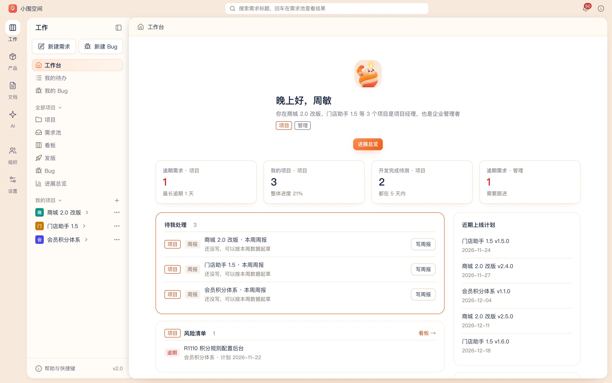
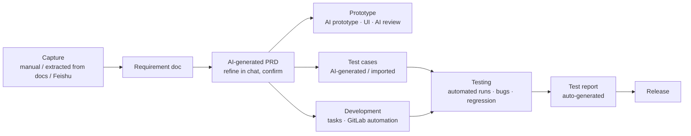
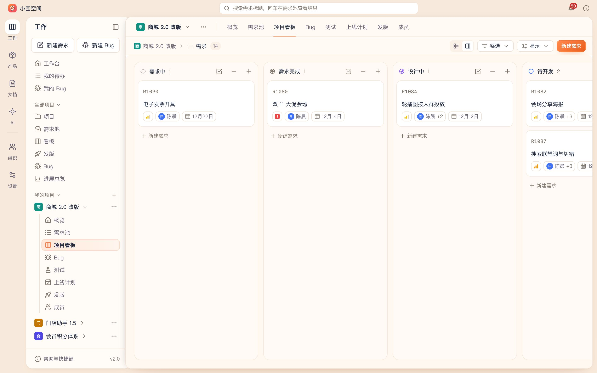
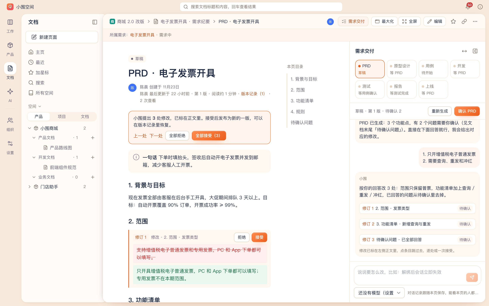
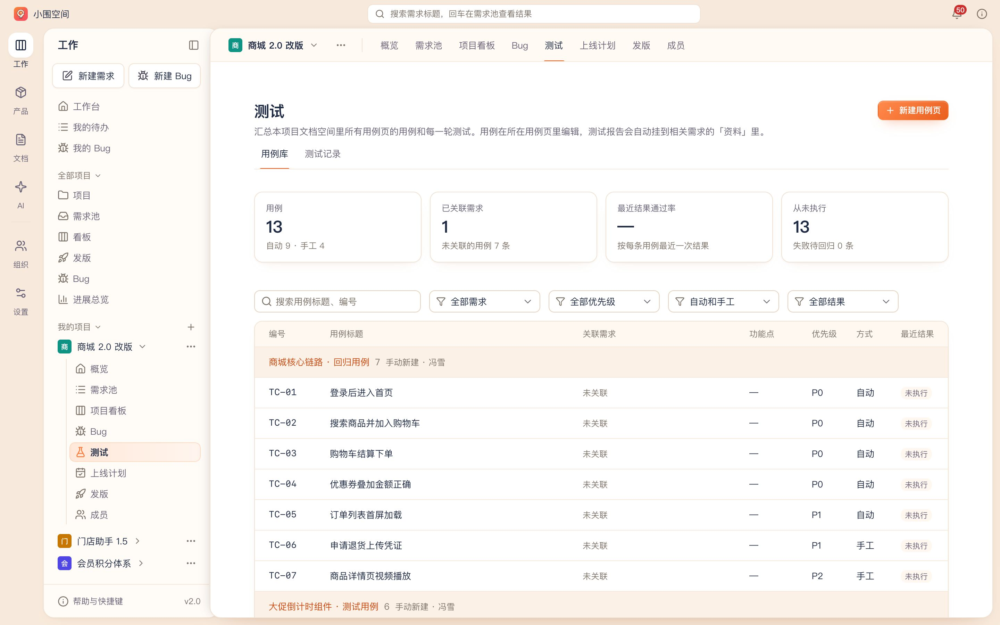
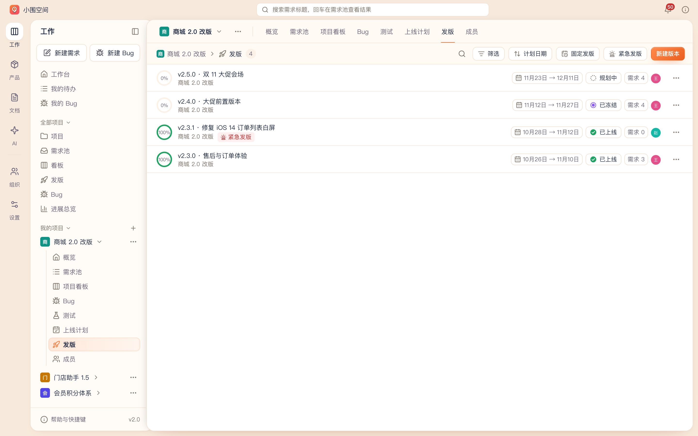
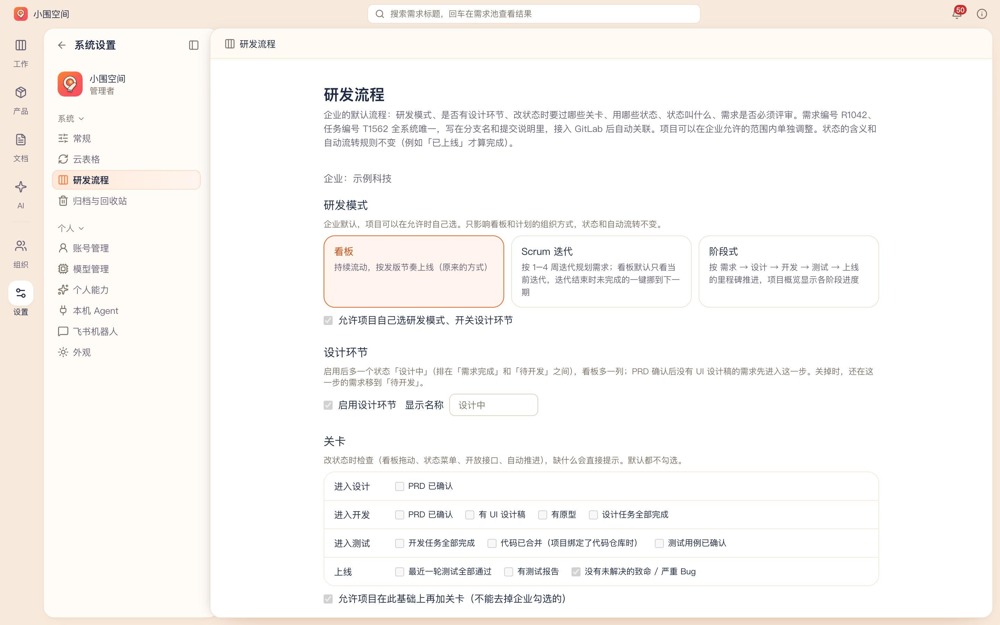
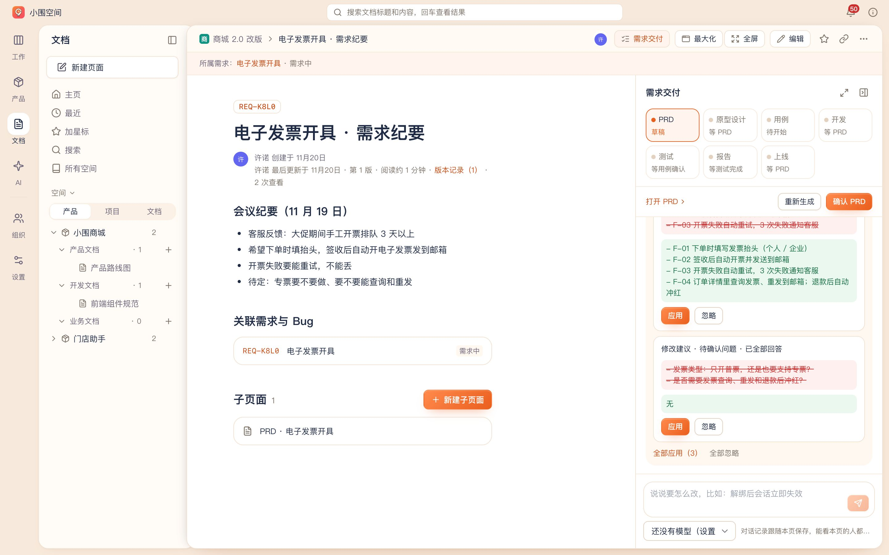
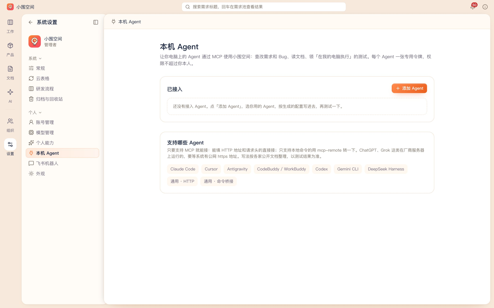

<div align="center">


# Weavi Space (小围空间)

**From requirement to release, with AI at every step.**

An open-source R&D collaboration platform for Chinese-speaking teams: requirements, PRDs, prototypes, tests, bugs, releases and a wiki in one place,<br>plus a built-in AI assistant ("Xiaowei") that works with your own permissions. The UI is in Simplified Chinese.

[Website](https://www.ncwoshou.com) · [Live demo (no sign-up)](https://demo.ncwoshou.com) · [Free cloud](https://collab.ncwoshou.com/login) · [中文](./README.md)




</div>

## How a requirement flows



Confirming a PRD splits it into implementation requirements, so development and test-case writing run in parallel. Statuses move forward automatically at PRD confirmation, task completion, passing test rounds and release.

## Features

| Role-based workbench | Kanban board |
|---|---|
|  |  |
| **AI requirement delivery (PRD side by side with chat)** | **Test cases and automated runs** |
|  |  |
| **Releases** | **Configurable flow (Kanban / Scrum / phased)** |
|  |  |
| **Wiki-style docs** | **Local agents via MCP** |
|  |  |

- **Role-based workbench**: 9 roles (business, product, designer, tech lead, developer, QA, project manager, enterprise manager, system admin). People with several roles see them merged on one page, with an "Inbox" ranked by urgency.
- **Requirements**: 10 statuses, drag-and-drop board, `R1042` / `T1562` codes, sub-requirements, comments, artifacts (Figma UI with embedded preview, sandboxed HTML prototypes, docs, test cases, reports), tasks generated from templates with schedules that shift with the requirement.
- **AI requirement delivery**: a 7-step panel on any requirement doc — PRD → prototype → test cases → development → testing → report → release. PRDs, prototypes, test cases and reports are generated from your materials and rendered live as they are written; refine the PRD through block-level suggestions in chat; AI review returns pass / conditional / fail with an issue list.
- **Testing and bugs**: import cases from Excel, CSV, YAML, JSON, Markdown tables, TestLink XML or XMind, or describe them in plain language. Runs execute on the server with Playwright (allow-listed URLs, failure screenshots) or on your own machine through Claude Code over MCP, with auto-login and per-precondition accounts. Failed cases become bugs; confirmed rounds produce a test report automatically.
- **Releases**: scheduled release trains (weekly / bi-weekly / monthly, auto-freeze), hotfix releases with a reason and linked bugs, release plans with risk flags.
- **Configurable process**: Kanban, Scrum iterations or phased milestones; optional requirement review, design stage and 11 quality gates; system → enterprise → project layering.
- **Docs and products**: Confluence-style spaces with versions, Mermaid, formulas and Excalidraw whiteboards; Feishu cloud doc import; product feature trees, environments and architecture diagrams; progress overview and scheduled weekly reports.
- **AI assistant**: chat, an agent mode that reads directly and asks before writing, automation rules (event or schedule triggered), personal skills (PRD, user stories, prototypes, test cases, reports, your own `SKILL.md`). Bring your own keys: DeepSeek, Qwen, Zhipu GLM, Kimi, Doubao, Claude, OpenAI, Gemini or any OpenAI-compatible endpoint, with per-enterprise token quotas.
- **Open APIs and MCP**: `POST /api/mcp` (Streamable HTTP) and `/api/v1` REST with scoped personal tokens; one-click setup for Claude Code, Cursor, Codex, Gemini CLI, CodeBuddy, Antigravity and generic HTTP clients.
- **GitLab**: gitlab.com or self-hosted; codes in branch names, commits and MR titles move tasks and requirements forward; tags mark releases as shipped.
- **Sign-in and sync**: Feishu (Lark), WeCom and DingTalk QR login, email / SMS codes; two-way Feishu Sheets sync; Feishu bot notifications.
- **Security**: strict multi-enterprise isolation, permission matrix, admins never see passwords (invite codes), encrypted phone numbers, CSRF origin checks, CSP nonces, sanitized rich text, rate limiting, optimistic locking.
- **Look**: "Weavi" warm and "Classic" blue styles, each in light and dark; responsive on narrow screens.

## Getting started

| Option | |
|---|---|
| Live demo | [demo.ncwoshou.com](https://demo.ncwoshou.com) with sample data, no sign-up |
| Free cloud | [collab.ncwoshou.com](https://collab.ncwoshou.com/login) |
| Docker | `docker compose` starts web, PostgreSQL 16 and MinIO — see [`docker/README.md`](./docker/README.md) |
| Plain install | Node.js 22 + PostgreSQL 16: `bash deploy/setup.sh` — see [`deploy/README.md`](./deploy/README.md) |

The first visit opens a setup wizard (`/setup`) where you set the super-admin password with an install code and can generate a demo organization. Forgot the admin password? Run `npm run reset-admin -- <email>` on the server.

## Tech stack

Next.js 16 (App Router) · React 19 · TypeScript · Tailwind CSS 3 · Prisma 5 + PostgreSQL 16 · npm workspaces · server-side sessions · pg-boss for background jobs · Excalidraw · Mermaid · playwright-core.

## Quick start (local)

Requires Node.js 22.5+ and PostgreSQL 16.

```bash
cp .env.example .env          # set DATABASE_URL, AUTH_SECRET (openssl rand -base64 48), COOKIE_SECURE=false
createdb pm_collab_local
npm ci
npx prisma migrate deploy
npm run db:seed               # demo data; wipes the database it points to (only allowed for local/demo/test names)
npm run dev                   # http://localhost:3100
```

Demo accounts are printed by the seed script and are for local use only.

## Deploy

- Plain install (Node.js + PostgreSQL on one server): `bash deploy/setup.sh`, see [`deploy/README.md`](./deploy/README.md).
- Docker Compose (web + PostgreSQL + MinIO): see [`docker/README.md`](./docker/README.md).
- Health check: `GET /api/healthz`. Backups: `deploy/backup.sh` / `deploy/restore.sh`.

Production needs `AUTH_SECRET` and `ENCRYPTION_KEY` (32+ characters each, never change `ENCRYPTION_KEY` once set), `APP_URL`, and `TRUST_PROXY=1` behind a reverse proxy. All options are documented in [`.env.example`](./.env.example).

## Development

```bash
npx tsc --noEmit -p .
npm run lint
npm run test:unit
npm run build
npx tsx scripts/security.check.ts
```

Schema changes go through `prisma/migrations` only (`npx prisma migrate dev --name <name>`). See [`CONTRIBUTING.md`](./CONTRIBUTING.md).

## Contact

Website: [www.ncwoshou.com](https://www.ncwoshou.com). Questions about deployment, rolling it out inside your company, or feature ideas? Scan the QR code to add the author on WeChat (mention "Weavi Space"), or open an Issue / PR.


How to scan: on a computer, open WeChat on your phone, tap "+" → "Scan" and point it at the code. On a phone, save or screenshot the image, then in WeChat "Scan" tap the album icon and pick it.

## License

[GNU AGPL-3.0](./LICENSE). You may use, modify and redistribute it. If you run a modified version as a network service, you must offer its complete source code to the users of that service (section 13). The in-app Help panel links to the source; set `NEXT_PUBLIC_SOURCE_CODE_URL` to your own repository when you deploy a modified version.

## Security

Please report vulnerabilities privately as described in [`docs/SECURITY.md`](./docs/SECURITY.md). Never paste keys, tokens or real customer data into public issues.
