<div align="center">


# 小围空间 Weavi Space

**需求到上线，AI 陪你走完每一步。**

开源的中文研发协同平台：需求、PRD、原型、测试、Bug、发版和知识库放在一处，<br>内置 AI 助手「小围」，权限和你一样大，能写 PRD、跑测试、接本机 Agent。

[官网](https://www.ncwoshou.com) · [在线演示（免注册）](https://demo.ncwoshou.com) · [免费云服务](https://collab.ncwoshou.com/login) · [English](./README.en.md)


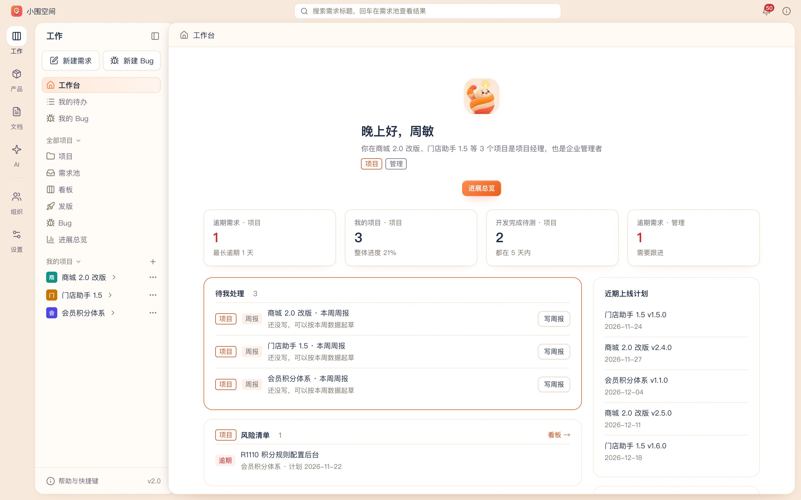

</div>

> **安全提示**：本仓库含本地演示种子账号。切勿把演示密码、`.env`、真实飞书 token、或含真实数据的数据库文件部署到公网。上线前请阅读 [`docs/SECURITY.md`](./docs/SECURITY.md)。

## 目录

- [为什么做小围空间](#为什么做小围空间)
- [一条需求怎么走完](#一条需求怎么走完)
- [功能详解](#功能详解)
  - [按角色的工作台](#按角色的工作台)
  - [需求全流程](#需求全流程)
  - [AI 需求交付：PRD → 原型 → 用例](#ai-需求交付prd--原型--用例)
  - [测试与 Bug](#测试与-bug)
  - [发版与上线计划](#发版与上线计划)
  - [研发流程可配置：看板、Scrum、阶段式](#研发流程可配置看板scrum阶段式)
  - [文档与知识库](#文档与知识库)
  - [产品、项目与进展](#产品项目与进展)
  - [AI 助手「小围」](#ai-助手小围)
  - [本机 Agent 与开放接口（MCP）](#本机-agent-与开放接口mcp)
  - [GitLab 集成](#gitlab-集成)
  - [飞书 / 企业微信 / 钉钉](#飞书--企业微信--钉钉)
  - [组织、权限与安全](#组织权限与安全)
- [快速开始](#快速开始)
- [技术栈](#技术栈)
- [本地开发安装](#本地开发安装)
- [部署](#部署)
- [贡献 · 联系作者 · 许可证](#贡献)

## 为什么做小围空间

研发团队每天都在补的那些洞：需求散在群聊和表格里、写 PRD 很费时间、测试靠人工一条条点、数据要手工在几个系统之间同步、AI 用得零零散散、发版靠记忆。小围空间把这些环节放进一个系统，并让 AI 直接参与进去：

- **一处闭环**：需求、文档、PRD、原型、用例、开发任务、测试、Bug、发版都在一起，彼此关联，状态自动往前推。
- **AI 真能干活**：PRD、原型、测试用例、测试报告由 AI 按你的资料生成，边写边实时显示；AI 用你本人的权限读写数据，写操作先等你确认。
- **能接你已有的工具**：飞书 / 企业微信 / 钉钉登录，飞书表格和云文档同步，GitLab 自动流转，Claude Code、Cursor 等本机 Agent 通过 MCP 直接读写需求和用例。
- **开源、可自部署**：AGPL-3.0，Docker 一键起，数据在自己手里；也可以直接用免费云服务。

## 一条需求怎么走完

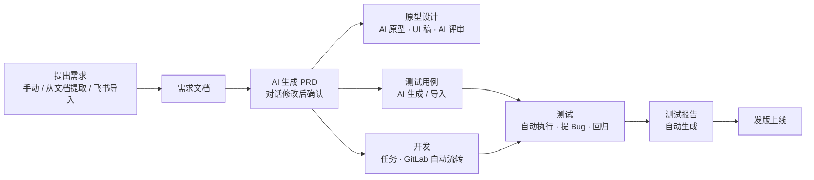

PRD 确认时会按功能点拆出实现需求，开发和写用例同时进行；状态在 PRD 确认、开发任务完成、测试通过、发版上线这些节点自动推进，不用手动改。

## 功能详解

### 按角色的工作台


- 9 个角色各有自己的工作台：业务方、产品经理、设计师、技术负责人、开发、测试、项目经理、企业管理者、系统管理员。
- **身兼多岗不用切换**：默认岗位、各项目里的岗位、管理角色合在一页，问候语下面写清楚「你在 A 是产品经理，在 B 是项目经理」。
- **待我处理**：评审、PRD 待确认、测试轮次、到期任务、Bug 退回、待验收、周报……按紧急程度排序（卡着别人 / 已逾期 → 今天 → 本周），每条带角色标签和直达按钮。
- 每个角色有专属指标卡和区块，比如业务方看「我提的进行中 / 本月已上线 / 待我验收」，产品看「新需求待梳理 / 评审中 / 本月上线」，开发看「今天要做 / 逾期任务 / 我的 Bug」，测试看「待测需求 / 进行中的轮次 / 待回归 Bug / 本周通过率」，管理者看「项目健康度 / 风险清单」。

### 需求全流程

| 看板 | 需求池 |
|---|---|
| 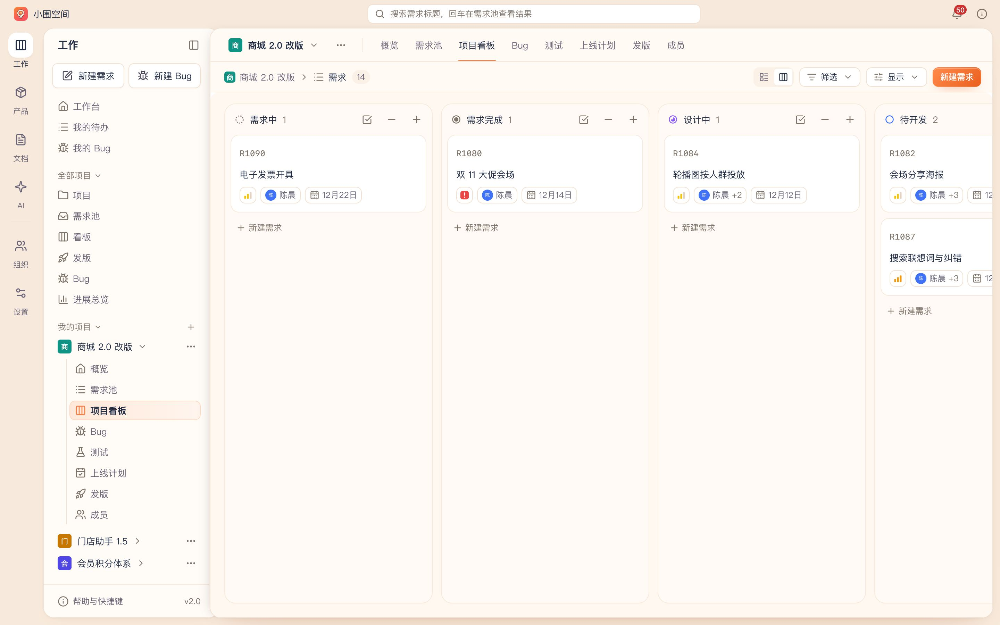 | 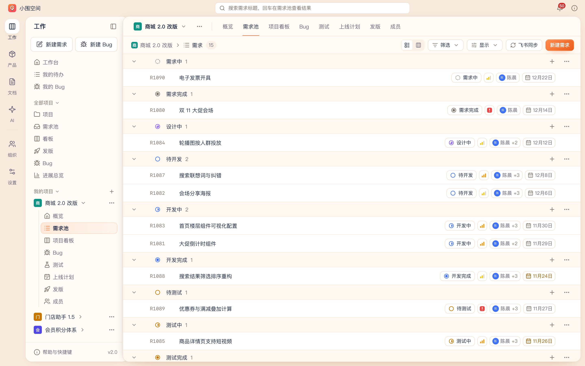 |

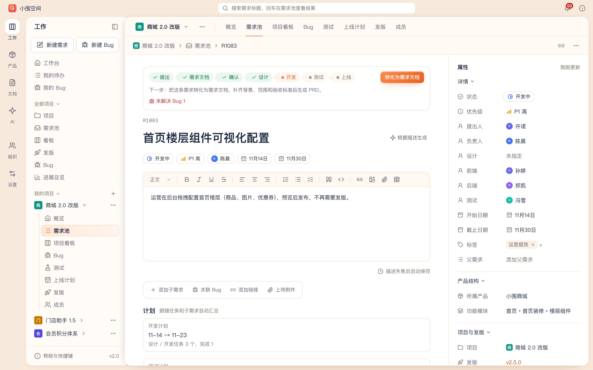

- **10 个状态**：需求中 → 需求完成 →（设计中）→ 待开发 → 开发中 → 开发完成 → 待测试 → 测试中 → 测试完成 → 已上线，另有已取消；只有「已上线」计为完成。
- **看板拖拽**改状态，带撤销、失败回滚；键盘和触屏也有等价操作。
- 需求编号 `R1042`，任务编号 `T1562`，搜索框直接输编号就能找到。
- **需求详情**：富文本描述（配图、附件）、子需求、评论、提出人、按岗位指定产品 / 前端 / 后端 / 测试负责人；顶部「需求进度」条随时告诉你下一步该做什么。
- **资料**：UI 设计稿（Figma 可内嵌预览）、HTML 原型（沙箱打开）、需求文档、测试用例、测试报告，一直带到发版。
- **任务与计划**：按模板一键生成设计 / 前端 / 后端 / 测试 / 发布任务；需求日期一改，没开始的任务自动平移；计划晚于发版上线日时提醒，一键挪到下一期。
- 需求池只在项目里，产品资料空间里的文档也能一键「提取需求」，由 AI 列出候选，勾选后批量建好。

### AI 需求交付：PRD → 原型 → 用例

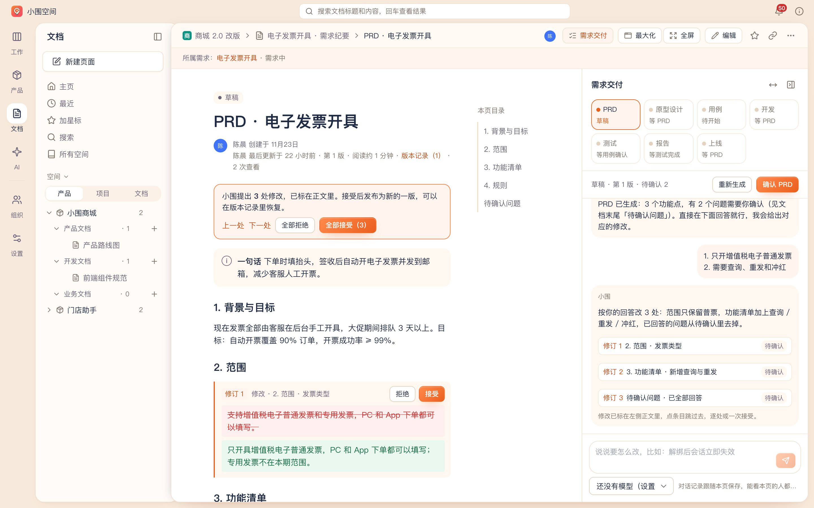

在任意一篇需求文档右上角点「需求交付」，右侧面板按 7 步带你走完：**PRD → 原型设计 → 用例 → 开发 → 测试 → 报告 → 上线**。

- **生成 PRD**：按需求文档和附件，用内置的 PRD 能力（基于 [caffrey-prd-plus](https://github.com/Caffrey-Li/caffrey-prd-plus)）和你选的模型生成；左侧实时显示正在写的文档（流程图、表格逐段渲染），右侧流式对话。
- **对照修改**：左文档、右对话。对话里给出块级「修改建议」，删改前后对照，一键应用（发布新版本）或撤销；文档末尾的「待确认问题」直接在对话里回答。
- **确认 PRD**：锁定版本，按功能点拆出实现需求（作为子需求），Bug 自动挂到对应需求。
- **原型设计**：按 PRD 生成可点击的 HTML 原型（左侧实时预览），或基于已有原型按要求修改；可挂 UI 设计稿地址，或生成一段指令让本机 Agent 在 Figma 里画好再写回。
- **AI 评审**：读 PRD、原型和 UI 稿，给出「通过 / 有条件通过 / 不通过」和问题清单，一键「按意见改原型 / 改 PRD」。
- **测试用例**：按已确认的 PRD 生成结构化用例，自动标出功能点覆盖率；PRD 改了会提示用例「依据已变更」。

### 测试与 Bug

| 测试用例与执行 | Bug |
|---|---|
| 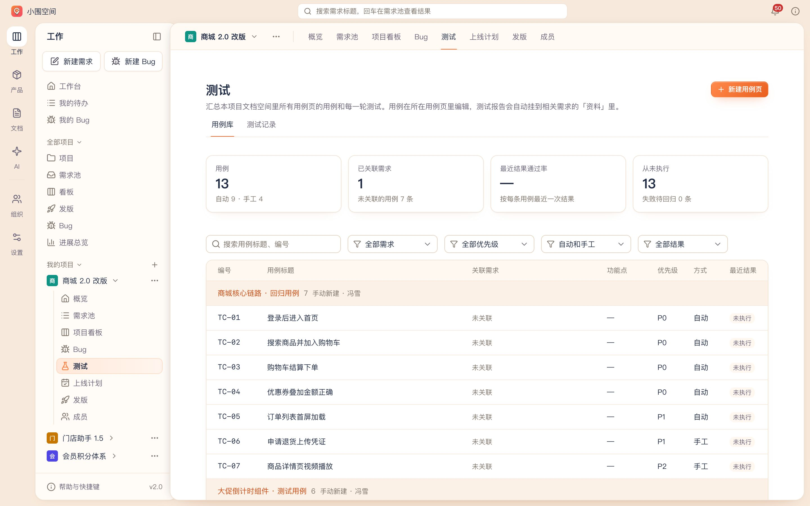 | 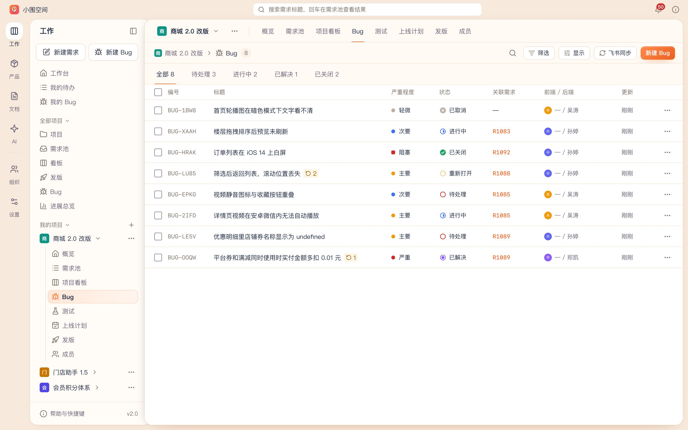 |

- **用例管理**：项目「测试」页集中管理用例库；支持导入 Excel、CSV（含从表格直接粘贴）、YAML、JSON、Markdown 表格、TestLink XML、XMind，自动识别格式和优先级；也能用自然语言描述直接转成用例。
- **自动执行**：结构化步骤在服务器上用 Playwright 逐条执行（地址白名单、失败截图），或者「在我的电脑执行」——本机 Claude Code 通过 MCP 领取用例、回传结果。支持自动登录、按前置条件换账号、上传或生成 Playwright 脚本。
- **实况对照**：左侧用例逐条变绿 / 变红，当前步骤高亮；手工用例可一键全部通过或跳过。
- **闭环**：失败用例一键提 Bug 并挂到需求；修好后提交回归；确认结果后**自动生成测试报告**写进文档空间。
- **Bug**：6 个状态，列表与看板两种视图，严重程度、退回次数统计、备注；需求可以批量移入 Bug。

### 发版与上线计划

| 发版 | 上线计划 |
|---|---|
| 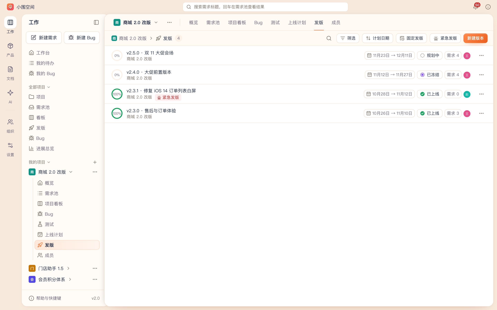 | 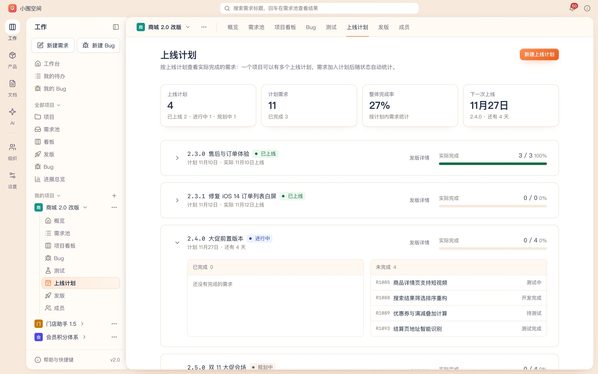 |

- **固定节奏发版**：每周 / 每两周 / 每月，版本号模板，自动保留未来 N 期、上线前 N 天自动冻结。
- **紧急发版**：必须填原因，关联要修的 Bug，上线时一并标记已解决。
- 规划 → 冻结 → 发布中 → 已上线；「标记上线」同步把需求改为已上线（先过上线关卡）。
- **上线计划**：按期看每个版本的需求、完成度和风险；计划晚于上线日的需求一眼看出。

### 研发流程可配置：看板、Scrum、阶段式

| 研发流程设置 | 迭代（Scrum） |
|---|---|
| 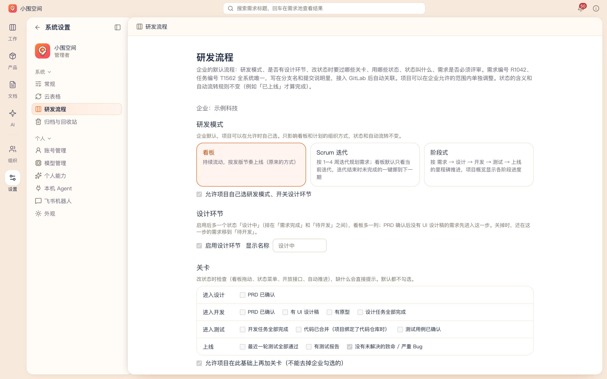 | 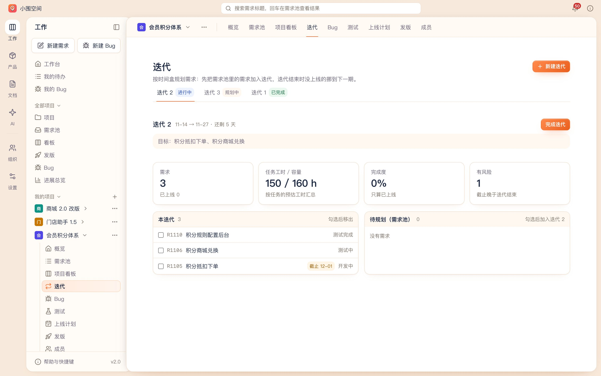 |

- **三种研发模式**：看板（持续流动）、Scrum 迭代（1–4 周迭代，看板默认只看当前迭代，结束时未完成的一键挪到下一期）、阶段式（按需求 → 设计 → 开发 → 测试 → 上线的里程碑推进）。
- **需求评审**：可要求评审通过才能进入开发；评审人按岗位默认或项目指定，不通过立即退回并通知。
- **设计环节**：打开后多出「设计中」，没有 UI 稿 / 原型的需求先进设计。
- **11 项关卡**：进入设计 / 开发 / 测试 / 上线前分别检查 PRD 已确认、有 UI 稿、有原型、开发任务完成、代码已合并、用例已确认、测试全部通过、有测试报告、没有未解决的严重 Bug 等，缺什么一次说清。
- **三层配置**：系统底线 → 企业默认 → 项目覆盖（企业允许时），可停用状态、改状态名称。

### 文档与知识库

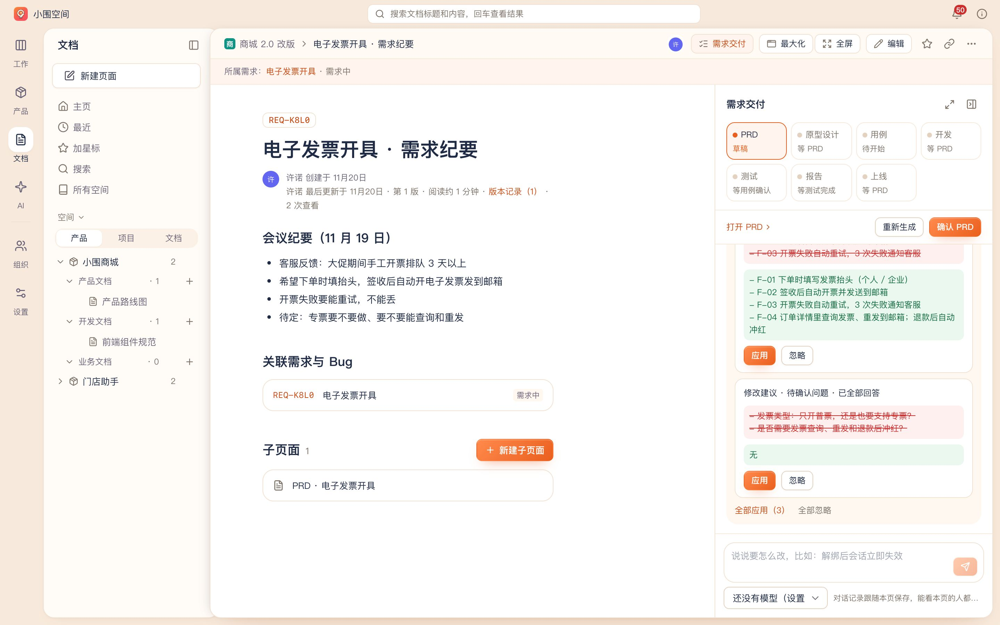

- **Confluence 式空间**：每个项目、每个产品一个空间，页面树、草稿自动保存、发布生成版本、历史可对比恢复。
- 「/」菜单插入各种块，支持 Mermaid 流程图、数学公式、提示块；**画布页**（Excalidraw 白板）。
- **Wiki 输出规范**：AI 写进文档空间的内容统一排版，每个人可以在个人能力页开关。
- **飞书云文档导入**：文档、知识库节点（含子页面）、文件夹单向导入到指定目录，再次同步更新同一页面并发布新版本。
- 需求文档顶部显示所属需求、「原型与设计」卡片和关联的 Bug。

### 产品、项目与进展

| 产品功能结构 | 进展总览 |
|---|---|
| 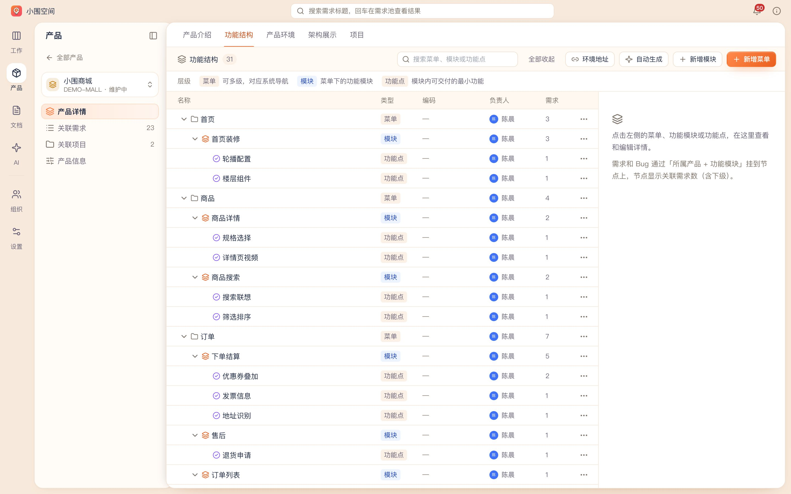 | 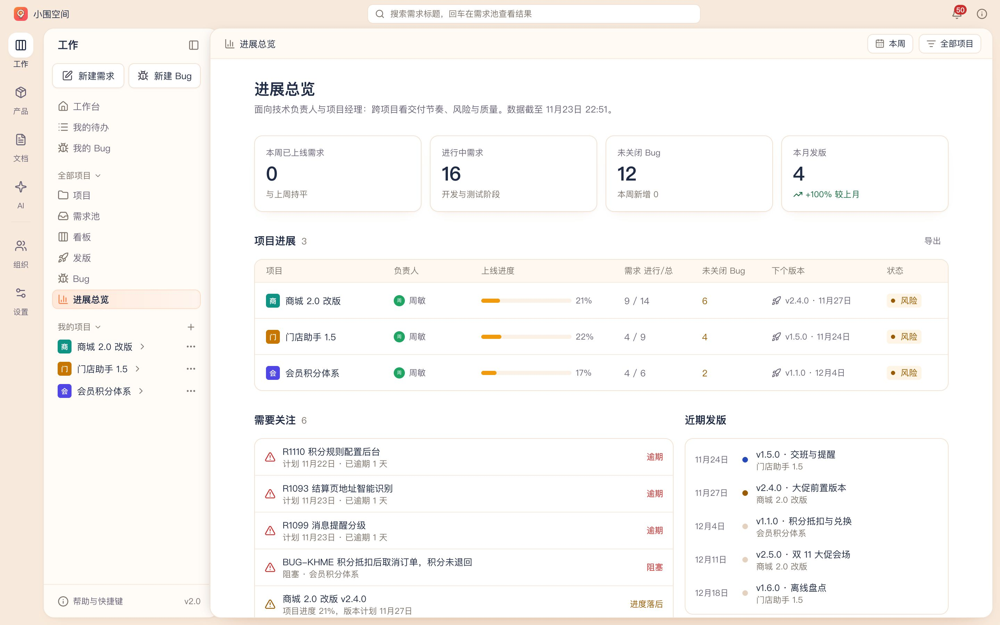 |

- **产品**：产品介绍、功能结构树（菜单 › 模块 › 功能点）、产品环境（内外网地址，测试执行只能选这里的地址）、架构图；需求和 Bug 挂到功能点上。
- **项目**：概览、成员与岗位、需求池、看板、Bug、测试、发版、上线计划、迭代。
- **进展总览**：所有项目的进度、上线情况、风险需求、近期发版，给管理者一页看全。
- **项目周报**：按本周数据起草，可定时发给项目成员；站内通知 + 飞书机器人推送。

### AI 助手「小围」

- **对话**：可以不关联、关联工作区或某个项目，问进展、找风险、写总结；对话保存在服务端。
- **动手模式（Agent）**：小围用 MCP 工具直接读写系统数据——只读操作直接做，写操作先挂起等你确认，用你本人的权限执行，每一步留痕；每个任务有步数和 token 上限。
- **自动化规则**：需求 / Bug 新建或状态变化、每天 / 工作日 / 每周定时触发小围，按规则创建人的权限执行（有熔断，企业可关闭）。
- **个人能力**：内置需求分析、PRD、拆用户故事、原型图、测试用例、测试报告等能力，也可以上传自己的 `SKILL.md`；结果可以直接存进文档空间。内置能力每天从 GitHub 检查更新。
- **模型**：DeepSeek、通义千问、智谱 GLM、Kimi、豆包、Claude、OpenAI、Gemini 及任意 OpenAI 兼容接口；个人模型或企业模型（企业可给成员设每天 / 每周 / 每月 token 定额）。写长文档时自动关闭模型「思考」，直接出正文。
- **AI 生图**：企业配置后可用来生成项目图标等图片，按企业单价记账、计入用量。

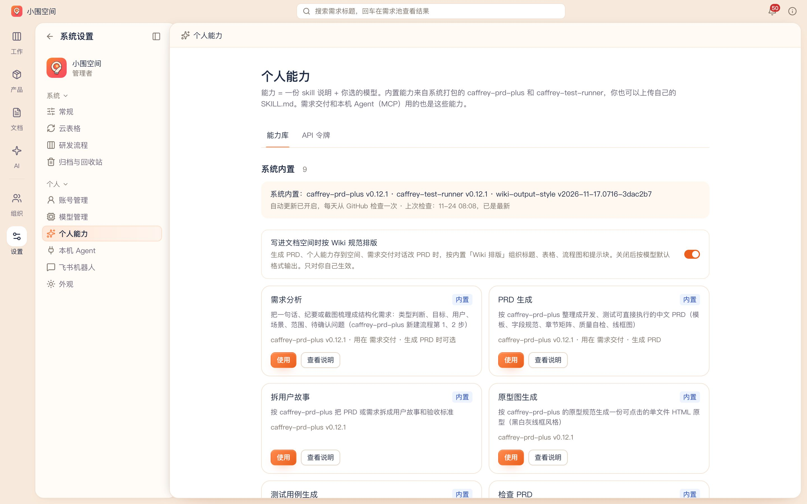

### 本机 Agent 与开放接口（MCP）

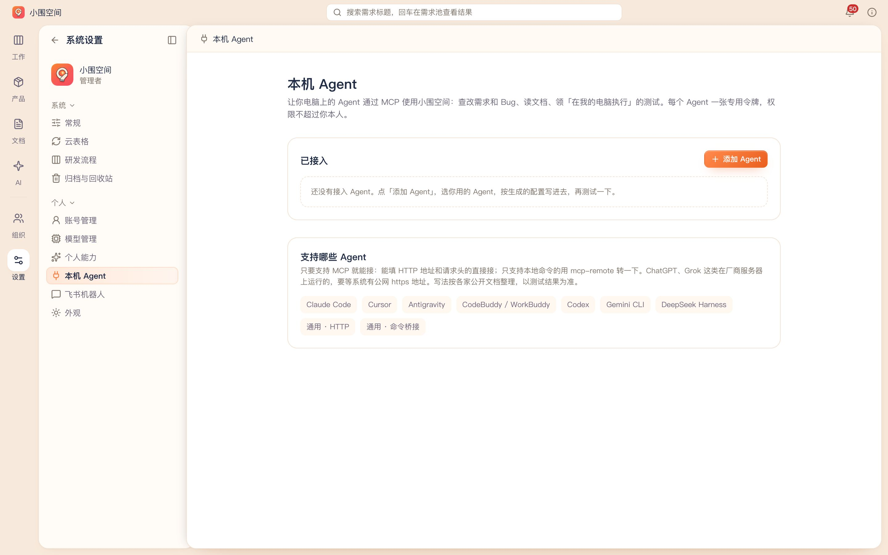

- **MCP 服务**：`POST /api/mcp`（Streamable HTTP），用个人 API 令牌鉴权，权限、数据范围和你本人一致；工具覆盖项目、需求、任务、资料、Bug、发版、文档、迭代、待我处理、测试执行等。
- **一键接入本机 Agent**：Claude Code、Cursor、Codex、Gemini CLI、CodeBuddy / WorkBuddy、Antigravity、DeepSeek Harness，以及通用 HTTP / 命令桥接；页面按 Agent 生成配置写法和专用令牌，并做三段连通测试。
- **开放接口 v1**：`/api/v1` REST 接口，个人令牌按 scope 授权（读需求、写需求、读文档……），明文只显示一次，可随时吊销。

### GitLab 集成

- 支持 gitlab.com 和公司自建 GitLab，企业级连接 + 项目绑定仓库。
- 从**分支名、提交说明、MR 标题**里识别 `R1042` / `T1562`：推送 → 任务和需求变「进行中 / 开发中」；MR 合并到默认分支 → 任务完成、需求变「开发完成 / 待测试」；按规则打标签或 Release → 发版自动标记上线。
- Webhook 实时接收，另有每 5 分钟定时拉取兜底；事件去重，可选在 MR 里自动评论关联的需求。

### 飞书 / 企业微信 / 钉钉

- **登录**：飞书、企业微信、钉钉扫码登录（每个企业用自己的应用），邮箱和短信验证码登录；企业专属登录链接。
- **飞书云表格**：需求 / Bug 与飞书表格双向同步（先拉取再回写，自动同步只能一个方向，带同步记录）。
- **飞书云文档**：导入文档空间（见上）。
- **飞书机器人**：按订阅推送通知。

### 组织、权限与安全

- **多企业隔离**：系统组织 › 企业 › 部门，除系统管理员外只能看到本企业数据；每个企业有唯一的企业超管。
- **角色与权限**：系统管理员 / 管理者 / 成员 / 自定义角色 / 访客，权限矩阵细到功能点；岗位（产品、设计、技术负责人、前端、后端、测试、项目经理、业务）。
- **管理员看不到密码**：新建账号用邀请码，重置只发重置链接；手机号加密存储、界面只显示脱敏值。
- 写请求 Origin 校验、页面 CSP nonce、富文本白名单清洗、上传魔数校验、登录限流和锁定、乐观锁防覆盖；MCP 访问受令牌 scope 管控并留日志。
- **外观**：「小围」暖色和「经典」蓝色两套风格，各有浅色 / 深色；窄屏自动适配。

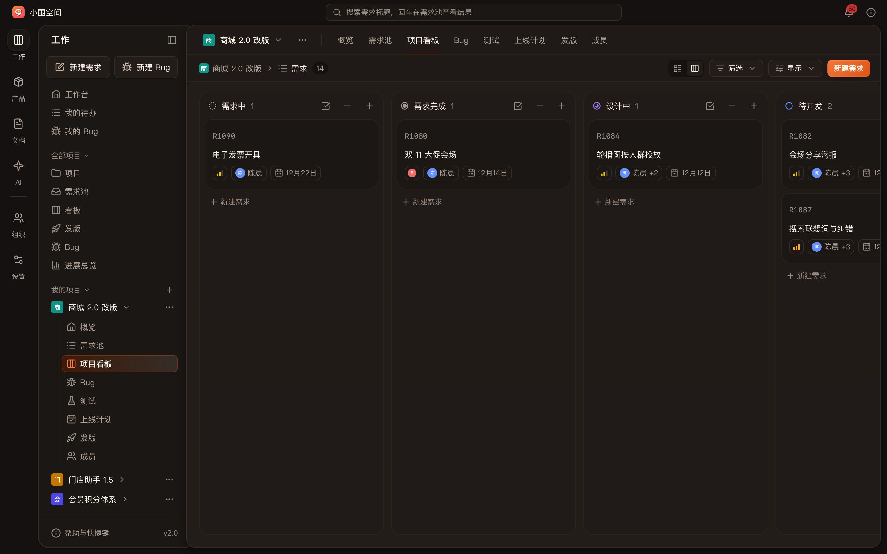

## 快速开始

| 方式 | 说明 |
|---|---|
| **在线演示** | 打开 [demo.ncwoshou.com](https://demo.ncwoshou.com)，带示例数据，不用注册；想要可编辑账号在 [官网](https://www.ncwoshou.com/demo/) 申请 |
| **免费云服务** | [collab.ncwoshou.com](https://collab.ncwoshou.com/login)，说明见 [官网 · 免费说明](https://www.ncwoshou.com/free/) |
| **Docker 自部署** | `docker compose` 一次起 Web、PostgreSQL 16 和 MinIO，详见 [`docker/README.md`](./docker/README.md) |
| **直接安装** | Node.js 22 + PostgreSQL 16：`bash deploy/setup.sh`，详见 [`deploy/README.md`](./deploy/README.md) |

部署后首次打开会进入**安装向导**（`/setup`，凭安装码自己设置超管密码），可勾选生成演示组织「示例科技」和体验账号。忘记超管密码时在服务器上执行 `npm run reset-admin -- <邮箱>`。

## 技术栈

- Next.js 16（App Router，Turbopack）· React 19 · TypeScript（strict）
- Tailwind CSS 3 · Prisma 5 + PostgreSQL 16 · npm workspaces（`apps/web`、`packages/core|db|ui`）
- 服务端会话（`sessions` 表 + 随机令牌 Cookie，`bcryptjs`）
- `@dnd-kit` 看板拖拽 · Excalidraw 画布 · Mermaid · `playwright-core` 测试执行 · pg-boss 任务队列
- 可选：飞书 / 企业微信 / 钉钉登录、邮箱和短信验证码、云表格 / 云文档同步、9 家大模型厂商、GitLab、MCP 服务

## 本地开发安装

在**仓库根目录**执行（不要依赖某台机器的绝对路径）：

需要 Node.js 22.5+ 和 PostgreSQL 16（macOS：`brew install postgresql@16 && brew services start postgresql@16`）。

```bash
cp .env.example .env
# 必要配置：
#   DATABASE_URL="postgresql://localhost:5432/pm_collab_local"   # 库名带 local / demo / test 时才允许 db:seed
#   AUTH_SECRET="<至少 32 位随机串>"  # 例：openssl rand -base64 48
#   COOKIE_SECURE=false               # 本机 http 调试需要

createdb pm_collab_local
npm ci                 # postinstall 会 prisma generate
npx prisma migrate deploy   # 按 prisma/migrations 建表（含默认工作区）
npm run db:seed        # ⚠ 会清空当前 DATABASE_URL 指向的库；仅用于新建的 local 库
npm run dev            # 默认开发端口见 package.json；也可用 npx next dev -p <端口>
```

改表结构：先改 `prisma/schema.prisma`，再 `npx prisma migrate dev --name <名称>` 生成迁移并一起提交；部署时 `npx prisma migrate deploy`。不要在启动代码里建表加列。

从旧的 SQLite 库搬数据：`DATABASE_URL=<新库> npx tsx scripts/migrate-sqlite-to-pg.ts --source <SQLite 副本> --dry-run`，确认报告后把 `--dry-run` 换成 `--yes`（用法见脚本文件头）。

生成密钥：

```bash
openssl rand -base64 48
```

常用检查：

```bash
npx tsc --noEmit -p .
npm run lint
npm run build
npx tsx scripts/security.check.ts
```

贡献流程见 [`CONTRIBUTING.md`](./CONTRIBUTING.md)。冒烟清单见 [`SMOKE_TEST.md`](./SMOKE_TEST.md)。

### 演示账号（仅限本地 seed）

`npm run db:seed` 会写入 `@local` 演示账号。完整口令只出现在本地 `prisma/seed.ts` 运行输出中，**仅用于本地 / CI 演示库**。生产、预发或任何公网实例禁止使用；生产环境用不合规密码登录会被强制改密。

### 飞书排期表同步（可选）

同步前在 `.env` 配置（缺任一必填项时同步会报「未配置」，不会回落写死地址）：

```bash
FEISHU_ITR_WIKI_URL=
FEISHU_ITR_SPREADSHEET_TOKEN=
FEISHU_ITR_SHEET_ID=
# 可选：FEISHU_ITR_SHEET_TITLE=  FEISHU_ITR_SOURCE_TITLE=
# 另需 FEISHU_USER_ACCESS_TOKEN 或 FEISHU_APP_ID + FEISHU_APP_SECRET
```

## 部署

- 直接安装（Node.js 22 + PostgreSQL 16，上传存本机磁盘）：`bash deploy/setup.sh`，详见 [`deploy/README.md`](./deploy/README.md)；部署到阿里云见 [`deploy/aliyun/README.md`](./deploy/aliyun/README.md)。
- 首次打开进入安装向导 `/setup`（安装码在启动日志里），自己设置超管密码。
- Docker：`docker compose` 一次起 Web、PostgreSQL 16 和 MinIO，详见 [`docker/README.md`](./docker/README.md)。

两种方式都有健康检查 `/api/healthz`、初始管理员创建和备份恢复脚本。

## 环境变量

模板见 [`.env.example`](./.env.example)。要点：

| 变量 | 说明 |
|------|------|
| `DATABASE_URL` | PostgreSQL 连接串，本地开发如 `postgresql://localhost:5432/pm_collab_local` |
| `AUTH_SECRET` | 生产必须 ≥ 32 位，否则拒绝启动 |
| `ENCRYPTION_KEY` | 推荐；配置加密专用密钥 |
| `COOKIE_SECURE` | 本机 http 调试设 `false` |
| `TRUST_PROXY` | 反代后才设为 `1` |
| `FEISHU_*` | 飞书登录与排期表同步 |
| `ANTHROPIC_API_KEY` | 可选：看板 AI 助手用 Claude 回答（其余 AI 功能在「模型管理」里按人 / 按企业配置） |

## 贡献

见 [`CONTRIBUTING.md`](./CONTRIBUTING.md)。Issue / PR 模板在 [`.github/`](./.github/)。

## 联系作者

官网：[www.ncwoshou.com](https://www.ncwoshou.com)。部署遇到问题、想在公司内部落地，或者有功能建议，欢迎扫码加作者微信（备注「小围空间」），也可以直接提 Issue / PR。


扫码方法：在电脑上看时，打开手机微信，点右上角「+」→「扫一扫」对准二维码；在手机上看时，先截图或保存图片，再到微信「扫一扫」点右上角相册图标选这张图。

## 许可证

[GNU AGPL-3.0](./LICENSE)。可以自由使用、修改和分发；把修改后的版本作为网络服务提供给他人时，须向这些用户公开对应的完整源代码（AGPL 第 13 条）。系统「帮助」面板里有源代码链接，部署修改版时用 `NEXT_PUBLIC_SOURCE_CODE_URL` 指向你自己的代码地址（构建时生效）。

## 安全

疑似漏洞请按 [`docs/SECURITY.md`](./docs/SECURITY.md) 处理，不要在公开 Issue 中粘贴密钥、token、真实客户数据。
